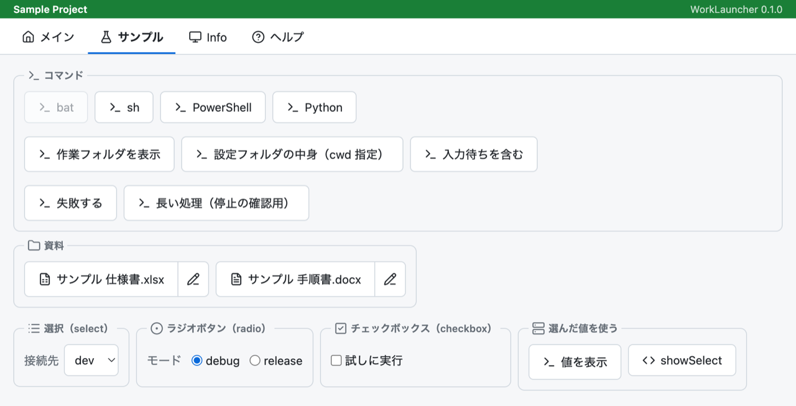

# WorkLauncher

[日本語](#日本語) | [English](#english)



## 日本語

WorkLauncher は、案件でよく使うコマンドや資料をボタンにまとめておくデスクトップアプリです。Windows と macOS で動きます。

ボタンは、リポジトリに置いた `launcher/config.yaml` に書きます。コマンドの実行（bat / sh / PowerShell / Python）、ファイルやフォルダを開く、URL を開く、JavaScript の関数を呼ぶ、といったボタンが作れます。自分の PC だけで使うボタンは `launcher/config.local.yaml` に書きます。

`launcher/` と並べて空の `work.launcher` ファイルを置いておくと、それをダブルクリックするだけで WorkLauncher が起動し、その案件のボタンが並びます。

設定の書き方は [docs/config.md](docs/config.md) にあります。アプリの最後のタブ「ヘルプ」にも、見本つきの説明があります。

### インストール

[Releases](../../releases) のページから、使う環境に合ったファイルをダウンロードします。

| ファイル                                          | 対象                                      |
| ------------------------------------------------- | ----------------------------------------- |
| `work-launcher-<ver>-win-x64-setup.exe`           | Windows（インストール版）                 |
| `work-launcher-<ver>-win-x64-portable.exe`        | Windows（ポータブル版。インストール不要） |
| `work-launcher-<ver>-mac-apple-silicon-arm64.dmg` | Mac（Apple Silicon: M1 以降）             |
| `work-launcher-<ver>-mac-intel-x64.dmg`           | Mac（Intel）                              |
| `work-launcher-sample-<ver>.zip`                  | 試しに使えるサンプル案件                  |

どちらの Mac かは「Apple メニュー > この Mac について」で確かめられます。「チップ: Apple M…」と出れば Apple Silicon、「プロセッサ: … Intel …」と出れば Intel です。

インストール版では、案件の `work.launcher` をダブルクリックするか、アプリのアイコンにドロップすると、その案件の画面が出ます。メニューの「ファイル > 案件を開く…」（Cmd+O / Ctrl+O）から選ぶこともできます。

まず試すなら、`work-launcher-sample-<ver>.zip` を展開して `sample/work.launcher` をダブルクリックしてください。ポータブル版の場合は、exe を `work.launcher` と同じフォルダに置いて exe を起動します。`sample/launcher/config.yaml` を書き換えて保存すると、すぐに画面へ反映されます。

アプリには署名がないので、初めて起動するときに OS が警告を出します。次の手順で開けます。

- Windows: 「Windows によって PC が保護されました」と出たら、「詳細情報」を押してから「実行」を押す
- macOS: 「“WorkLauncher”は開いていません」と出たら、「システム設定 > プライバシーとセキュリティ」を開いて下へスクロールし、WorkLauncher の「このまま開く」を押す（初回だけ）

### セキュリティ

WorkLauncher は、個人やチームの中で使う前提で作っています。`config.local.yaml` は自分で書き、共有の `launcher/` の設定は信頼できる人が書いたもの、たとえばチームのリポジトリでレビューを通したものだけを使う、という想定です。

設定に書いたコマンドやスクリプトは、あなたの PC の上で何でも実行できます。そのため、WorkLauncher を使うときは、その案件の設定を信頼できるかどうかを先に考えてください。具体的には次のように動きます。

- コマンドのボタン（bat / sh / PowerShell / Python）は、押すとすぐに実行する
- `info.tools` の `command` は、Info タブを開いたときにシェルで実行する
- `open` は、プログラムを含めてどのファイルでも開ける
- `url` とリンクが開くのは、`openSchemes` に並べたスキームの URL だけ（既定は `http`・`https`・`mailto`）。`file` を足すと、手元や共有フォルダのファイルも開けるようになる

`scripts`（JavaScript）だけは、動かす前に案件フォルダごとに1回確認します。ただし一度許可すると、あとでファイルが変わっても聞き直しません。

知らない人から受け取ったファイルは使わないでください。`launcher/` の変更は、コードと同じようにレビューしてください。ほかの人も書き込める共有フォルダに置いた案件は、特に気をつけてください。

WorkLauncher が自分からインターネットに何かを送ることはありません。テレメトリも自動更新もありません。ネットワークを使うのは、次の3つの場合だけです。

- md / html の埋め込みに `https://` の画像があり、そのページを表示したとき
- リンクや `url` のボタンを押して、ブラウザで開いたとき
- 自分で書いたコマンドやスクリプトがネットワークを使うとき

### 開発

Node.js 24 が必要です。バージョンは `mise.toml` で [mise](https://mise.jdx.dev/) に固定しています。

```bash
npm install
npm run dev     # examples/sample を開く
npm test
npm run build
```

### リリース

`main` は保護しています。変更は PR で入れ、CI（Windows と macOS での lint・typecheck・test）が通ってからマージします。`v*` のタグを push できるのは管理者だけです。

1. ブランチで `package.json` の `version` を上げ（例: `0.1.0`）、PR を作ってマージする
2. `git tag -a v0.1.0 -m v0.1.0 && git push origin v0.1.0` を実行する。注釈付きタグにしておくと、タグのページに最後のコミットのメッセージではなくバージョンが出る
3. GitHub Actions が Windows と macOS でビルドし、ファイルを添えた下書きの Release を作る。タグと `package.json` のバージョンが一致していないと失敗する
4. Releases のページで下書きを確かめ、ノートを直してから「Publish release」を押す。公開した Release はあとから変えられない（Immutable releases）

リリースせずにビルドだけしたいときは、Actions タブから Release ワークフローを手動で実行します。できたファイルは、その実行の Artifacts に置かれます。

#### ダウンロードしたファイルを確かめる

ファイルに署名はありませんが、どの Release にも `SHA256SUMS.txt` と build provenance の attestation（ビルド元の証明）を付けています。これで、このリポジトリのワークフローがビルドしたファイルかどうかを確かめられます。

```bash
gh attestation verify work-launcher-0.1.0-win-x64-setup.exe -R kazunori0909/work-launcher
```

セキュリティの問題を見つけたときは、[SECURITY.md](SECURITY.md) の手順で報告してください。

### ライセンス

[MIT](LICENSE) ライセンスです。アプリに入っているライブラリのライセンスは、アプリの「ヘルプ > ライセンス」で一覧できます。この一覧は、ビルドのときに `scripts/licenses.mjs` が集めています。

## English

WorkLauncher is a desktop app that puts the commands and documents you use for a project behind buttons. It runs on Windows and macOS.

You write the buttons in `launcher/config.yaml` in your repository. A button can run a command (bat / sh / PowerShell / Python), open a file or folder, open a URL, or call a JavaScript function. Buttons that only you need go in `launcher/config.local.yaml`.

Put an empty `work.launcher` file next to `launcher/`, and double-clicking it starts WorkLauncher with that project's buttons.

The configuration is described in [docs/config.md](docs/config.md) (Japanese). The last tab in the app, Help, also explains it with live examples. The app's menus and help are in Japanese.

### Install

Download the file for your system from the [Releases](../../releases) page.

| File                                              | For                                       |
| ------------------------------------------------- | ----------------------------------------- |
| `work-launcher-<ver>-win-x64-setup.exe`           | Windows installer                         |
| `work-launcher-<ver>-win-x64-portable.exe`        | Windows, no install (commit it to a repo) |
| `work-launcher-<ver>-mac-apple-silicon-arm64.dmg` | Mac with Apple Silicon (M1 or later)      |
| `work-launcher-<ver>-mac-intel-x64.dmg`           | Mac with Intel                            |
| `work-launcher-sample-<ver>.zip`                  | A sample project to try                   |

To check which Mac you have, open "Apple menu > About This Mac". If it shows "Chip: Apple M…", you have Apple Silicon; if it shows "Processor: … Intel …", you have Intel.

With the installed app, double-click a project's `work.launcher` or drop it on the app icon. You can also pick one from the menu "ファイル > 案件を開く…" (File > Open Project, Cmd+O / Ctrl+O).

To try the sample, unzip `work-launcher-sample-<ver>.zip` and double-click `sample/work.launcher`. With the portable version, put the exe in the same folder as `work.launcher` and run the exe. Edit `sample/launcher/config.yaml` and save, and the window updates right away.

The apps are not code-signed, so the OS shows a warning the first time you run them:

- Windows: when "Windows protected your PC" appears, click "More info", then "Run anyway"
- macOS: when "Apple could not verify…" appears, open "System Settings > Privacy & Security", scroll down, and click "Open Anyway" for WorkLauncher (only the first time)

### Security

WorkLauncher is made for personal and team use. It assumes that you write your own `config.local.yaml`, and that the shared `launcher/` settings come from people you trust, for example settings reviewed in your team's repository.

Commands and scripts in the settings can run anything on your PC. Before you use WorkLauncher with a project, make sure you trust its settings. In practice:

- Command buttons (bat / sh / PowerShell / Python) run as soon as you click them
- `command` in `info.tools` runs in a shell when you open the Info tab
- `open` can open any file, including programs
- `url` buttons and links open only the URL schemes listed in `openSchemes` (default: `http`, `https`, `mailto`). Adding `file` lets them open local and shared files too

Only `scripts` (JavaScript) asks before running, once per project folder. After you allow it, it does not ask again, even if the files change.

Do not use files from people you do not know. Review changes to `launcher/` the way you review code, and take extra care with projects in shared folders that others can write to.

WorkLauncher never sends anything to the internet on its own. There is no telemetry and no automatic update. It uses the network only when:

- an md / html embed has an image from an `https://` URL and you view that page
- you click a link or a `url` button and it opens in your browser
- your own commands or scripts use the network

### Development

You need Node.js 24. The version is pinned in `mise.toml` for [mise](https://mise.jdx.dev/).

```bash
npm install
npm run dev     # opens examples/sample
npm test
npm run build
```

### Release

`main` is protected. Changes go in through pull requests, and CI (lint, typecheck and test on Windows and macOS) must pass before merging. Only the admin can push `v*` tags.

1. On a branch, bump `version` in `package.json` (e.g. `0.1.0`), then open a pull request and merge it
2. Run `git tag -a v0.1.0 -m v0.1.0 && git push origin v0.1.0`. With an annotated tag, the tag page shows the version instead of the last commit message
3. GitHub Actions builds on Windows and macOS and creates a draft release with the files. It fails if the tag does not match the version in `package.json`
4. Check the draft on the Releases page, edit the notes, and click "Publish release". A published release cannot be changed (immutable releases)

To build without releasing, run the Release workflow manually from the Actions tab. The files are attached to that run as artifacts.

#### Verifying a download

The files are not code-signed, but every release comes with `SHA256SUMS.txt` and a build provenance attestation. With them, you can check that a file was built by this repository's workflow:

```bash
gh attestation verify work-launcher-0.1.0-win-x64-setup.exe -R kazunori0909/work-launcher
```

To report a security problem, follow [SECURITY.md](SECURITY.md).

### License

[MIT](LICENSE). The licenses of the libraries bundled in the app are listed under "ヘルプ > ライセンス" (Help > Licenses) in the app. `scripts/licenses.mjs` collects them at build time.
