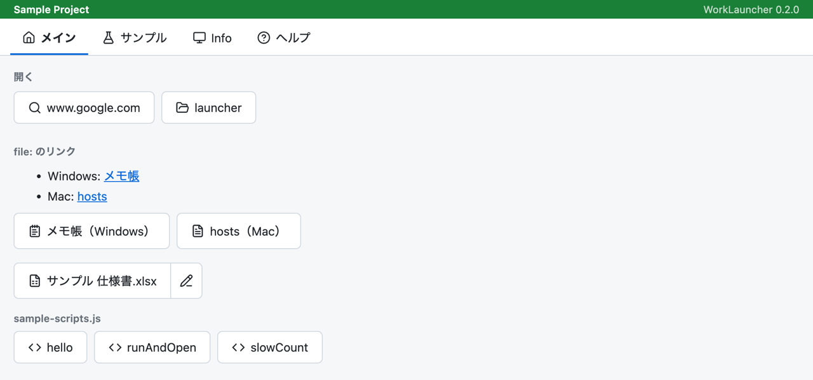
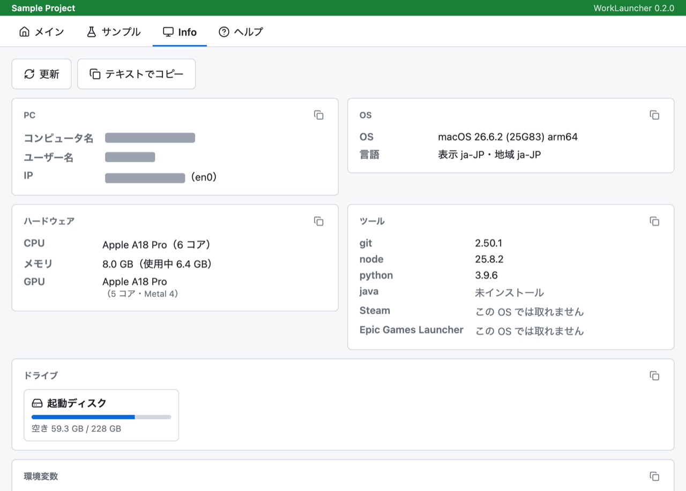

# WorkLauncher

[日本語](#日本語) | [English](#english)


## 日本語

WorkLauncher は、案件でよく使うコマンド・資料・URL をボタンにまとめておくデスクトップアプリです。Windows と macOS で動きます。

- 案件のリポジトリに YAML を置くだけで、ページとボタンが並ぶ
- bat / sh / PowerShell / Python のスクリプトを、ボタン1つで実行して結果を見られる
- 検索やチケット起票の URL を、日本語のパラメータのまま書ける
- PC の情報（OS・CPU・ツールのバージョン・Windows のレジストリなど）を1画面で確かめ、テキストでコピーできる

### しくみ

案件のリポジトリに、次のファイルを置きます。

```
my-project/
  work.launcher        # 空のファイル。ダブルクリックで起動する
  launcher/
    config.yaml        # ページとボタンの定義（チームで共有する）
    config.local.yaml  # 自分の PC だけで使うボタン（任意）
```

`work.launcher` をダブルクリックすると WorkLauncher が起動し、その案件のボタンが並びます。`config.yaml` を書き換えて保存すると、すぐに画面へ反映されます。

設定の書き方は [docs/config.md](docs/config.md) にあります。アプリの最後のタブ「ヘルプ」にも、見本つきの説明があります。

### できること

ここに載せている画面と設定は、Releases で配っているサンプル案件（[examples/sample](examples/sample)）のものです。

#### ボタンを並べる



```yaml
pages:
  - id: main
    title: メイン
    icon: house # アイコンは lucide の名前で選ぶ
    items:
      - heading: 開く
      - url: https://www.google.com/search
        params:
          q: ほげほげ
        icon: search
      - open: launcher # フォルダやファイルを開く
      - break:
      - excel: docs/サンプル 仕様書.xlsx
        readonly: true # 読み取り専用で開く
      - function: hello # launcher/scripts/*.js の関数を呼ぶ
```

| 書き方                                 | 押したときの動き                       |
| -------------------------------------- | -------------------------------------- |
| `url`                                  | 既定のブラウザで開く                   |
| `open`                                 | ファイル・フォルダを開く               |
| `excel` / `word` / `powerpoint`        | Office で開く（読み取り専用も選べる）  |
| `bat` / `sh` / `powershell` / `python` | スクリプトを実行し、出力をコンソールへ |
| `function`                             | JavaScript の関数を呼ぶ                |

ほかに、説明文の埋め込み（`md` / `html`）、枠で囲むグループ（`group`）、選択肢（`select` / `radio` / `checkbox`）も置けます。ページは別ファイルに分けて `include` できます。

#### スクリプトを実行する（bat / sh / PowerShell / Python）

冒頭の画面は、次の設定の「Python」ボタンを押したところです。出力は画面下のコンソールに流れ、終了コードも出ます。

```yaml
- group: コマンド
  icon: terminal
  items:
    - python: |
        import datetime, platform
        print(f"こんにちは、Python {platform.python_version()} です")
        print(f"OS: {platform.system()} {platform.release()}")
      label: Python
    - powershell: Write-Output "こんにちは、PowerShell $($PSVersionTable.PSVersion) です"
      label: PowerShell
    # sh と bat を1つのボタンに書くと、Mac では sh、Windows では bat が動く
    - sh: ls
      bat: dir /b
      cwd: launcher
      label: 設定フォルダの中身
```

- bat は Windows だけで動きます。sh は Windows では Git Bash で、PowerShell は Mac では pwsh（PowerShell 7）で動きます
- `confirm` で実行前に確かめたり、`env` で環境変数を渡したりできます。長い処理はコンソールから止められます
- `select` などで選んだ値を `${select:ID}` で埋め込めます（例: 接続先を選んでからデプロイする）
- コンソールの行は、`launcher/console.yaml` に書いた正規表現でエラー・警告・成功に色分けできます

#### URL のパラメータを日本語で書く

`params` に書いた値は、自動で URL エンコードして `?q=...` の形で付けます。日本語や改行を含む値も、そのまま書けます。

```yaml
- url: https://www.google.com/search
  params:
    q: ほげほげ
```

チケットの起票画面を、決まった書式で開くボタンにもできます。Redmine の新規チケット画面は `issue[...]` のパラメータで項目を埋められるので、次のように書くとテンプレートになります（GitHub の `issues/new?title=...&body=...` なども同じように書けます）。

```yaml
- url: https://redmine.example.com/projects/my-project/issues/new
  label: 不具合チケットを起票
  icon: bug
  params:
    issue[tracker_id]: 1
    issue[subject]: 【不具合】
    issue[description]: |
      ■ 発生環境
      接続先: ${select:target}

      ■ 再現手順
      1.

      ■ 期待する動作

      ■ 実際の動作
```

`${select:target}` は、同じページの `select` で選んだ値に置き換わります。

#### Info ページ

PC の情報を1画面にまとめて表示します。「テキストでコピー」で全体を、各枠の右上のボタンでその枠だけを、貼り付け用のテキストにできます。問い合わせのときに環境を伝えたり、新しく来た人の PC の準備ができているかを確かめたりするのに使えます。



| 表示する内容                   | Windows | Mac |
| ------------------------------ | :-----: | :-: |
| OS・言語                       |   ✅    | ✅  |
| コンピュータ名・ユーザー名・IP |   ✅    | ✅  |
| CPU・メモリ・GPU               |   ✅    | ✅  |
| メモリの内訳（1枚ずつ）        |   ✅    |  —  |
| ドライブの空き容量             |   ✅    | ✅  |
| 環境変数                       |   ✅    | ✅  |
| ツールのバージョン             |   ✅    | ✅  |
| Steam・Epic Games Launcher     |   ✅    |  —  |
| レジストリの値                 |   ✅    |  —  |

- 言語: Windows ではシステムロケールとコードページ（例: `cp932`）も出します
- GPU: Windows ではモデルとドライバーのバージョン、Mac ではモデル・コア数・Metal のバージョンを出します
- ドライブ: Windows は固定・リムーバブル・ネットワークドライブ、Mac は Finder に出るボリュームです

PC・OS・ハードウェアの枠は常に出ます。ドライブも既定で出ます（`drives: false` で消せます）。環境変数・ツール・レジストリは、`config.yaml` の `info` で選びます。

```yaml
info:
  env: [PATH, JAVA_HOME]
  tools:
    - git # 組み込み: git・node・npm・python・java・docker・dotnet
    - node
    - name: Maven # 組み込みに無いものは、コマンドと取り出し方を書く
      command: mvn -v
      pattern: "Apache Maven ([\\d.]+)"
  registry: # Windows だけ表示する
    - HKLM\SYSTEM\CurrentControlSet\Control\FileSystem\LongPathsEnabled
    - name: Windows Ver.
      path: HKLM\SOFTWARE\Microsoft\Windows NT\CurrentVersion\DisplayVersion
```

ツールは案件のフォルダで実行するので、mise などで案件ごとにバージョンを切り替えていれば、そのバージョンが出ます。

### インストール

[Releases](../../releases) のページから、使う環境に合ったファイルをダウンロードします。

| ファイル                                          | 対象                                      |
| ------------------------------------------------- | ----------------------------------------- |
| `work-launcher-<ver>-win-x64-setup.exe`           | Windows（インストール版）                 |
| `work-launcher-<ver>-win-x64-portable.exe`        | Windows（ポータブル版。インストール不要） |
| `work-launcher-<ver>-mac-apple-silicon-arm64.dmg` | Mac（Apple Silicon: M1 以降）             |
| `work-launcher-<ver>-mac-intel-x64.dmg`           | Mac（Intel）                              |
| `work-launcher-sample-<ver>.zip`                  | 試しに使えるサンプル案件                  |

どちらの Mac かは「Apple メニュー > この Mac について」で確かめられます。「チップ: Apple M…」と出れば Apple Silicon、「プロセッサ: … Intel …」と出れば Intel です。

インストール版では、案件の `work.launcher` をダブルクリックするか、アプリのアイコンにドロップすると、その案件の画面が出ます。メニューの「ファイル > 案件を開く…」（Cmd+O / Ctrl+O）から選ぶこともできます。

まず試すなら、`work-launcher-sample-<ver>.zip` を展開して `sample/work.launcher` をダブルクリックしてください。ポータブル版の場合は、exe を `work.launcher` と同じフォルダに置いて exe を起動します。`sample/launcher/config.yaml` を書き換えて保存すると、すぐに画面へ反映されます。

アプリには署名がないので、初めて起動するときに OS が警告を出します。次の手順で開けます。

- Windows: 「Windows によって PC が保護されました」と出たら、「詳細情報」を押してから「実行」を押す
- macOS: 「“WorkLauncher”は開いていません」と出たら、「システム設定 > プライバシーとセキュリティ」を開いて下へスクロールし、WorkLauncher の「このまま開く」を押す（初回だけ）

### セキュリティ

WorkLauncher は、個人やチームの中で使う前提で作っています。`config.local.yaml` は自分で書き、共有の `launcher/` の設定は信頼できる人が書いたもの、たとえばチームのリポジトリでレビューを通したものだけを使う、という想定です。

設定に書いたコマンドやスクリプトは、あなたの PC の上で何でも実行できます。そのため、WorkLauncher を使うときは、その案件の設定を信頼できるかどうかを先に考えてください。具体的には次のように動きます。

- コマンドのボタン（bat / sh / PowerShell / Python）は、押すとすぐに実行する
- `info.tools` の `command` は、Info タブを開いたときにシェルで実行する
- `open` は、プログラムを含めてどのファイルでも開ける
- `url` とリンクが開くのは、`openSchemes` に並べたスキームの URL だけ（既定は `http`・`https`・`mailto`）。`file` を足すと、手元や共有フォルダのファイルも開けるようになる

`scripts`（JavaScript）だけは、動かす前に案件フォルダごとに1回確認します。ただし一度許可すると、あとでファイルが変わっても聞き直しません。

知らない人から受け取ったファイルは使わないでください。`launcher/` の変更は、コードと同じようにレビューしてください。ほかの人も書き込める共有フォルダに置いた案件は、特に気をつけてください。

WorkLauncher が自分からインターネットに何かを送ることはありません。テレメトリも自動更新もありません。ネットワークを使うのは、次の3つの場合だけです。

- md / html の埋め込みに `https://` の画像があり、そのページを表示したとき
- リンクや `url` のボタンを押して、ブラウザで開いたとき
- 自分で書いたコマンドやスクリプトがネットワークを使うとき

### 開発

Node.js 24 が必要です。バージョンは `mise.toml` で [mise](https://mise.jdx.dev/) に固定しています。

```bash
npm install
npm run dev     # examples/sample を開く
npm test
npm run build
```

### リリース

`main` は保護しています。変更は PR で入れ、CI（Windows と macOS での lint・typecheck・test）が通ってからマージします。`v*` のタグを push できるのは管理者だけです。

1. ブランチで `package.json` の `version` を上げ（例: `0.1.0`）、PR を作ってマージする
2. `git tag -a v0.1.0 -m v0.1.0 && git push origin v0.1.0` を実行する。注釈付きタグにしておくと、タグのページに最後のコミットのメッセージではなくバージョンが出る
3. GitHub Actions が Windows と macOS でビルドし、ファイルを添えた下書きの Release を作る。タグと `package.json` のバージョンが一致していないと失敗する
4. Releases のページで下書きを確かめ、ノートを直してから「Publish release」を押す。公開した Release はあとから変えられない（Immutable releases）

リリースせずにビルドだけしたいときは、Actions タブから Release ワークフローを手動で実行します。できたファイルは、その実行の Artifacts に置かれます。

#### ダウンロードしたファイルを確かめる

ファイルに署名はありませんが、どの Release にも `SHA256SUMS.txt` と build provenance の attestation（ビルド元の証明）を付けています。これで、このリポジトリのワークフローがビルドしたファイルかどうかを確かめられます。

```bash
gh attestation verify work-launcher-0.1.0-win-x64-setup.exe -R kazunori0909/work-launcher
```

セキュリティの問題を見つけたときは、[SECURITY.md](SECURITY.md) の手順で報告してください。

### ライセンス

[MIT](LICENSE) ライセンスです。アプリに入っているライブラリのライセンスは、アプリの「ヘルプ > ライセンス」で一覧できます。この一覧は、ビルドのときに `scripts/licenses.mjs` が集めています。

## English

WorkLauncher is a desktop app that puts the commands, documents and URLs you use for a project behind buttons. It runs on Windows and macOS.

- Put a YAML file in your project's repository, and its pages and buttons appear
- Run bat / sh / PowerShell / Python scripts with one click and see the output
- Write search and issue-form URLs with plain-text parameters, Japanese included
- See your PC's details (OS, CPU, tool versions, Windows registry values and more) on one screen, and copy them as text

The app's menus and help are in Japanese, so the screenshots below are too.

### How it works

Put these files in your project's repository:

```
my-project/
  work.launcher        # an empty file; double-click it to start
  launcher/
    config.yaml        # pages and buttons, shared with your team
    config.local.yaml  # buttons only you need (optional)
```

Double-click `work.launcher`, and WorkLauncher starts with that project's buttons. Edit `config.yaml` and save, and the window updates right away.

The configuration is described in [docs/config.md](docs/config.md) (Japanese). The last tab in the app, Help, also explains it with live examples.

### Features

The screens and settings here come from the sample project ([examples/sample](examples/sample)) that ships with each release.

#### Buttons


```yaml
pages:
  - id: main
    title: メイン
    icon: house # icons are lucide names
    items:
      - heading: 開く
      - url: https://www.google.com/search
        params:
          q: ほげほげ
        icon: search
      - open: launcher # open a folder or file
      - break:
      - excel: docs/サンプル 仕様書.xlsx
        readonly: true # open read-only
      - function: hello # call a function in launcher/scripts/*.js
```

| Key                                    | What the button does                    |
| -------------------------------------- | --------------------------------------- |
| `url`                                  | Opens it in your default browser        |
| `open`                                 | Opens a file or folder                  |
| `excel` / `word` / `powerpoint`        | Opens it in Office (read-only optional) |
| `bat` / `sh` / `powershell` / `python` | Runs the script; output goes to console |
| `function`                             | Calls a JavaScript function             |

You can also embed text (`md` / `html`), frame items in a `group`, and add choices (`select` / `radio` / `checkbox`). Pages can live in separate files and be pulled in with `include`.

#### Scripts (bat / sh / PowerShell / Python)

The screenshot at the top shows the "Python" button below after a click. The output streams into the console at the bottom, followed by the exit code.

```yaml
- group: コマンド
  icon: terminal
  items:
    - python: |
        import datetime, platform
        print(f"こんにちは、Python {platform.python_version()} です")
        print(f"OS: {platform.system()} {platform.release()}")
      label: Python
    - powershell: Write-Output "こんにちは、PowerShell $($PSVersionTable.PSVersion) です"
      label: PowerShell
    # with both sh and bat on one button, macOS runs sh and Windows runs bat
    - sh: ls
      bat: dir /b
      cwd: launcher
      label: 設定フォルダの中身
```

- bat runs on Windows only. On Windows, sh runs in Git Bash; on macOS, PowerShell needs pwsh (PowerShell 7)
- `confirm` asks before running, and `env` passes environment variables. You can stop a long run from the console
- Values picked in a `select` (and the like) go into scripts as `${select:ID}`, e.g. choose a target, then deploy
- Regular expressions in `launcher/console.yaml` color console lines as errors, warnings or successes

#### URL parameters in plain text

Values under `params` are URL-encoded for you and added as `?q=...`. Write them as they are, Japanese and line breaks included.

```yaml
- url: https://www.google.com/search
  params:
    q: ほげほげ
```

This also turns an issue form into a template button. Redmine's new-issue page fills its fields from `issue[...]` parameters, so this opens a pre-filled bug report (GitHub's `issues/new?title=...&body=...` works the same way):

```yaml
- url: https://redmine.example.com/projects/my-project/issues/new
  label: Report a bug
  icon: bug
  params:
    issue[tracker_id]: 1
    issue[subject]: '[Bug] '
    issue[description]: |
      * Environment
      Target: ${select:target}

      * Steps to reproduce
      1.

      * Expected

      * Actual
```

`${select:target}` is replaced with the value picked in a `select` on the same page.

#### Info page

The Info page gathers your PC's details on one screen. "テキストでコピー" (Copy as text) copies everything, and the button at the top right of each box copies just that box. Use it to share your environment when asking for help, or to check that a new member's PC is ready.


| Shows                        | Windows | Mac |
| ---------------------------- | :-----: | :-: |
| OS, language                 |   ✅    | ✅  |
| Computer name, user name, IP |   ✅    | ✅  |
| CPU, memory, GPU             |   ✅    | ✅  |
| Memory modules (one by one)  |   ✅    |  —  |
| Free space on drives         |   ✅    | ✅  |
| Environment variables        |   ✅    | ✅  |
| Tool versions                |   ✅    | ✅  |
| Steam, Epic Games Launcher   |   ✅    |  —  |
| Registry values              |   ✅    |  —  |

- Language: on Windows, it also shows the system locale and code page (e.g. `cp932`)
- GPU: on Windows, the model and driver version; on macOS, the model, core count and Metal version
- Drives: on Windows, fixed, removable and network drives; on macOS, the volumes shown in Finder

The PC, OS and hardware boxes always appear, and drives appear by default (hide them with `drives: false`). Environment variables, tools and registry values are chosen under `info` in `config.yaml`:

```yaml
info:
  env: [PATH, JAVA_HOME]
  tools:
    - git # built in: git, node, npm, python, java, docker, dotnet
    - node
    - name: Maven # for anything else, give a command and what to pick out
      command: mvn -v
      pattern: "Apache Maven ([\\d.]+)"
  registry: # shown on Windows only
    - HKLM\SYSTEM\CurrentControlSet\Control\FileSystem\LongPathsEnabled
    - name: Windows Ver.
      path: HKLM\SOFTWARE\Microsoft\Windows NT\CurrentVersion\DisplayVersion
```

Tools run in the project folder, so if you switch versions per project with a tool like mise, you see that project's version.

### Install

Download the file for your system from the [Releases](../../releases) page.

| File                                              | For                                       |
| ------------------------------------------------- | ----------------------------------------- |
| `work-launcher-<ver>-win-x64-setup.exe`           | Windows installer                         |
| `work-launcher-<ver>-win-x64-portable.exe`        | Windows, no install (commit it to a repo) |
| `work-launcher-<ver>-mac-apple-silicon-arm64.dmg` | Mac with Apple Silicon (M1 or later)      |
| `work-launcher-<ver>-mac-intel-x64.dmg`           | Mac with Intel                            |
| `work-launcher-sample-<ver>.zip`                  | A sample project to try                   |

To check which Mac you have, open "Apple menu > About This Mac". If it shows "Chip: Apple M…", you have Apple Silicon; if it shows "Processor: … Intel …", you have Intel.

With the installed app, double-click a project's `work.launcher` or drop it on the app icon. You can also pick one from the menu "ファイル > 案件を開く…" (File > Open Project, Cmd+O / Ctrl+O).

To try the sample, unzip `work-launcher-sample-<ver>.zip` and double-click `sample/work.launcher`. With the portable version, put the exe in the same folder as `work.launcher` and run the exe. Edit `sample/launcher/config.yaml` and save, and the window updates right away.

The apps are not code-signed, so the OS shows a warning the first time you run them:

- Windows: when "Windows protected your PC" appears, click "More info", then "Run anyway"
- macOS: when "Apple could not verify…" appears, open "System Settings > Privacy & Security", scroll down, and click "Open Anyway" for WorkLauncher (only the first time)

### Security

WorkLauncher is made for personal and team use. It assumes that you write your own `config.local.yaml`, and that the shared `launcher/` settings come from people you trust, for example settings reviewed in your team's repository.

Commands and scripts in the settings can run anything on your PC. Before you use WorkLauncher with a project, make sure you trust its settings. In practice:

- Command buttons (bat / sh / PowerShell / Python) run as soon as you click them
- `command` in `info.tools` runs in a shell when you open the Info tab
- `open` can open any file, including programs
- `url` buttons and links open only the URL schemes listed in `openSchemes` (default: `http`, `https`, `mailto`). Adding `file` lets them open local and shared files too

Only `scripts` (JavaScript) asks before running, once per project folder. After you allow it, it does not ask again, even if the files change.

Do not use files from people you do not know. Review changes to `launcher/` the way you review code, and take extra care with projects in shared folders that others can write to.

WorkLauncher never sends anything to the internet on its own. There is no telemetry and no automatic update. It uses the network only when:

- an md / html embed has an image from an `https://` URL and you view that page
- you click a link or a `url` button and it opens in your browser
- your own commands or scripts use the network

### Development

You need Node.js 24. The version is pinned in `mise.toml` for [mise](https://mise.jdx.dev/).

```bash
npm install
npm run dev     # opens examples/sample
npm test
npm run build
```

### Release

`main` is protected. Changes go in through pull requests, and CI (lint, typecheck and test on Windows and macOS) must pass before merging. Only the admin can push `v*` tags.

1. On a branch, bump `version` in `package.json` (e.g. `0.1.0`), then open a pull request and merge it
2. Run `git tag -a v0.1.0 -m v0.1.0 && git push origin v0.1.0`. With an annotated tag, the tag page shows the version instead of the last commit message
3. GitHub Actions builds on Windows and macOS and creates a draft release with the files. It fails if the tag does not match the version in `package.json`
4. Check the draft on the Releases page, edit the notes, and click "Publish release". A published release cannot be changed (immutable releases)

To build without releasing, run the Release workflow manually from the Actions tab. The files are attached to that run as artifacts.

#### Verifying a download

The files are not code-signed, but every release comes with `SHA256SUMS.txt` and a build provenance attestation. With them, you can check that a file was built by this repository's workflow:

```bash
gh attestation verify work-launcher-0.1.0-win-x64-setup.exe -R kazunori0909/work-launcher
```

To report a security problem, follow [SECURITY.md](SECURITY.md).

### License

[MIT](LICENSE). The licenses of the libraries bundled in the app are listed under "ヘルプ > ライセンス" (Help > Licenses) in the app. `scripts/licenses.mjs` collects them at build time.
